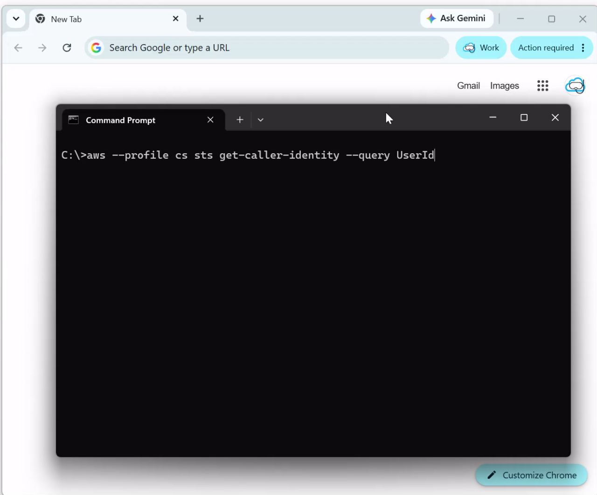

<p align="center">
  
</p>

# SSO Zen

[](https://golang.org/)
[](https://fyne.io/)
[](LICENSE)

A small cross-platform tray app that watches your local SSO sessions and notifies you before they expire. AWS SSO today. Provider model for Okta / Google / Azure AD next.

<p align="center">
  
</p>

## What it does

- Shows every AWS SSO profile in one place with a live status — Active, Expiring Soon, or Expired.
- Notifies you before a session expires, and again when it does.
- One-click Login button per profile — no digging for the right `aws sso login --profile` command.
- Optional early check that hits AWS as you approach expiry, so you don't get false-alarm "expiring soon" toasts when your credentials have quietly been refreshed.
- Optional background listener that catches credential failures the moment they happen mid-command, not the next time you look at the tray.

## Install

Grab the latest release from [Releases](https://github.com/CloudSnorkel/sso-zen/releases):

- **Windows** — `sso-zen-windows-<v>.exe.zip`
- **macOS** — `sso-zen-darwin-<v>.app.zip`
- **Linux** — `sso-zen-linux-<v>.tar.xz`

Building from source is covered in [CONTRIBUTING.md](CONTRIBUTING.md).

## AWS setup

Configure profiles the usual way:

```ini
[sso-session my-sso]
sso_start_url = https://your-portal.awsapps.com/start
sso_region = us-east-1

[profile dev]
sso_session = my-sso
sso_account_id = 123456789012
sso_role_name = AdministratorAccess
region = us-east-1
```

Legacy profiles (with `sso_start_url` directly on the profile, no `sso-session`) work too.

## Settings

- **General**: start with computer.
- **AWS CSM**: enable the background listener that catches credential failures mid-command. Turning this on edits `~/.aws/config` (the app cleans up when you turn it off or quit).
- **Notifications**: expiring-soon and expired toasts, how many minutes before expiry to warn, and the optional early check that talks to AWS to avoid false alarms.

## License

Apache License 2.0 with the [Commons Clause](https://commonsclause.com/) addendum - see [LICENSE](LICENSE).

Free for personal use, internal company use, modifying, and free redistribution (modified or not). **Selling the software is not permitted** under the Commons Clause — that covers paid app-store listings, paid hosted services, and bundling with paid software.
